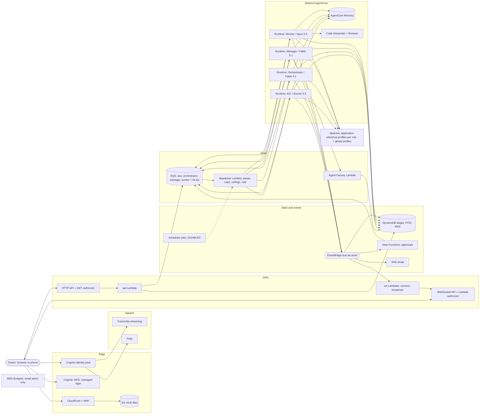

# Architecture

AI City runs entirely in the owner's AWS account, in one region (`eu-north-1` by default), as one environment (`prod`). Agents run on Amazon Bedrock AgentCore with Claude models billed through Bedrock; everything else is serverless. Decisions are in `docs/adr/` and `docs/DECISIONS.md`. Editable diagram: `docs/architecture.drawio` (preview `docs/architecture.png`).

## The hierarchy as code

| Agent | Where it runs | Session ID | Model | Tools |
|---|---|---|---|---|
| AIC | runtime `aic_prod_ace` | `ace-<owner>-<conversation>` | Sonnet 5.5 | `delegate_to_orchestrator`, `get_status`, `answer_question`, `instruct_agent`, notes, reminders, `pause_city`, `resume_city` |
| Orchestrator | runtime `aic_prod_orchestrator` | `orch-<task>` | Fable 5.1 → Opus 5.5 | `create_department`, `assign_to_department`, `get_reports`, `sign_off`, `ask_owner`, `report_to_ace` |
| Manager (one per department) | runtime `aic_prod_manager` | `mgr-<department>-<task>` | Fable 5.1 → Opus 5.5 | `hire_worker`, `assign`, `answer_worker`, `review`, `release_worker`, `save_specialist`, `ask_owner`, `report_to_orchestrator` |
| Worker (any number) | runtime `aic_prod_worker` (async job ≤ 8 h) | `wkr-<department>-<hireId>` | Opus 5.5 | granted built-ins (shell, files, git, web, Code Interpreter, Browser) + `ask_manager`, `report_to_manager` |

Departments and workers are data and sessions, never new runtimes, so the account stays far below AgentCore's runtime quota while hiring is unlimited.

## A request, end to end
1. The owner types or speaks. The HUD posts `/messages`; the API queues a message for AIC (`aic-prod-ace`).
2. The **dispatcher** takes it: pause flag → spend caps (only if the owner set one; none by default) → for workers, concurrency ceilings and the new-session rate → a lease on the message (idempotency) → `InvokeAgentRuntime`.
3. Inside the runtime, the **startup guard** has already refused to run without `CLAUDE_CODE_USE_BEDROCK=1` or with any other credential. The **host** reads the ledger, builds the prompt (stable system prompt first, for prompt caching), and runs one **gated turn**: caps again, throttling back-off, Fable → Opus fallback once, a cost row in the ledger and a `cost.update` event.
4. Every tool call passes the **policy gate** (`backend/src/aic/shared/policy.py`): deny rules (cloud mutation, force-push, push to main, credential files, merging), ask rules (become an approval bound to the exact action, via Step Functions), and the call is audited in the ledger.
5. Tools change the ledger, put events on the bus and queue the next agent's message, then the turn ends. Nobody waits in a session: the next turn starts when a report arrives.
6. Events fan out: to the WebSocket (City view, AIC's streamed reply), to the ledger (ticket trace) and to SNS (results, cap alerts, pause).
7. The Orchestrator signs off (PASS/FAIL) before anything leaves the city; AIC tells the owner.

## Shared code
- `backend/src/aic/shared` (Python): model map (`config/models.json` is the only place model IDs live), startup guard, policy gate, single-table ledger (one implementation over a `Table` interface with in-memory and DynamoDB backends), cost math (5-minute vs 1-hour cache writes, geo surcharge, Haiku long-context tier), spend caps, event schemas (Pydantic), the turn gate, the dispatcher's decisions, the Agent Factory, the actions shared by tools and API, utility (Haiku) calls and the wake word.
- `backend/src/aic/runtime` (Python): the AgentCore container (Starlette on 8080, arm64; image built from `services/agent-runtime/Dockerfile`), role tools, the Claude Agent SDK engine.
- `backend/src/aic/lambdas` (Python 3.13, one zip for all functions): api, dispatcher, factory, ledger writer, ws (authorizer, connections, broadcast), notifier, approvals, apps (stages a worker's `app.submitted` as a checked draft), app bridge (an app's granted read-only data reads, invoked by the api), scheduler (+ the fenced, disabled self-improvement check).
- `web`: React HUD; the City view is ported from the owner's Mac HUD (`web/src/city/`).

## Data model (DynamoDB, one table)
| Item | pk / sk | Index |
|---|---|---|
| Ticket | `TICKET#id` / `META`, history `HIST#…` | gsi1 `TICKET#<status>`, gsi2 `DEPT#<key>` |
| Agent (hire) | `AGENT#id` / `META`, spec `SPEC` | gsi1 `AGENT#<state>`, gsi2 `DEPT#<key>` |
| Department | `DEPT#key` / `META` | gsi1 `DEPT` |
| Specialist | `SPEC#id` / `META` | gsi1 `SPEC` |
| Question | `Q#id` / `META` | gsi1 `Q#open|answered` |
| Approval / owner approval | `APPROVAL#id` / `META`; `APPROVED#<hash>` / id | gsi1 `APPROVAL#<status>` |
| App draft / published app | `APPDRAFTS` / `DRAFT#<draft_id>`; `APPS` / `APP#<app_id>` | — |
| Turn (cost row) | `TURN#agent` / `<at>#…` | gsi1 `TURNDAY#<day>` |
| Spend counters | `SPEND#DAY#<date>` or `SPEND#MONTH#<month>` / `GLOBAL`, `DEPT#…`, `ROLE#…`, `MODEL#…` | — |
| Worker slots, session rate | `SLOTS` / `GLOBAL`, `DEPT#…`; `RATE` / `<second>` | — |
| Work lease (idempotency) | `WORK#<message>` / `META` | gsi1 `WORK#started` (crash sweep) |
| Settings, pause flag | `CONFIG` / `city` | — |
| Event trace, tool audit, notes, reminders | `EVENT#ticket`, `TOOL#agent`, `NOTE#…`, `REMINDER#…` | gsi1 |

## Infrastructure
Terraform in `infra/`: `envs/prod` (the only root; `deploy.yml` creates its state bucket on the first run and the owner provides the OIDC deploy role), modules `security`, `auth`, `storage`, `ledger`, `bus`, `agents`, `api`, `frontend`, `budgets`, `observability`. Every taggable resource carries `Project`, `App`, `Environment`, `Owner`, `ManagedBy`, `CostCenter` (provider default tags) and `Component`; runtimes, inference profiles and memories also carry `AgentRole` (checked by `scripts/check-tags.mjs`).
